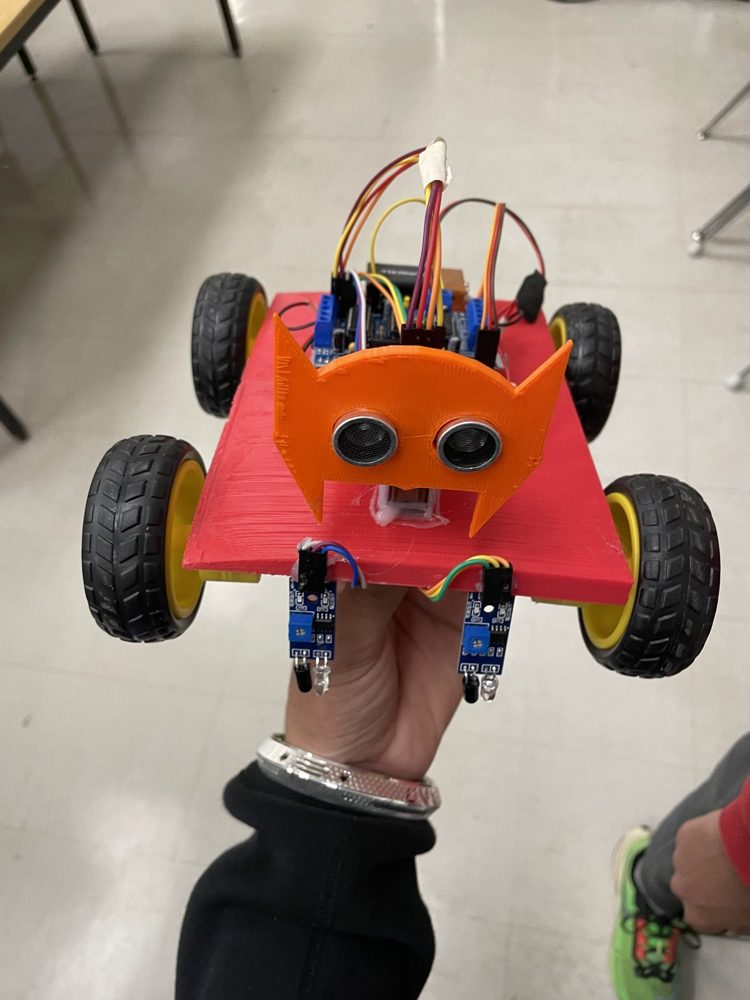
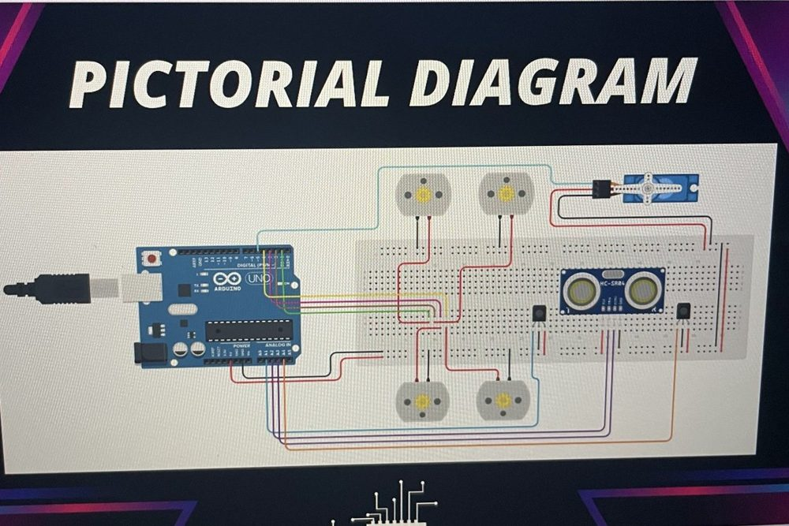
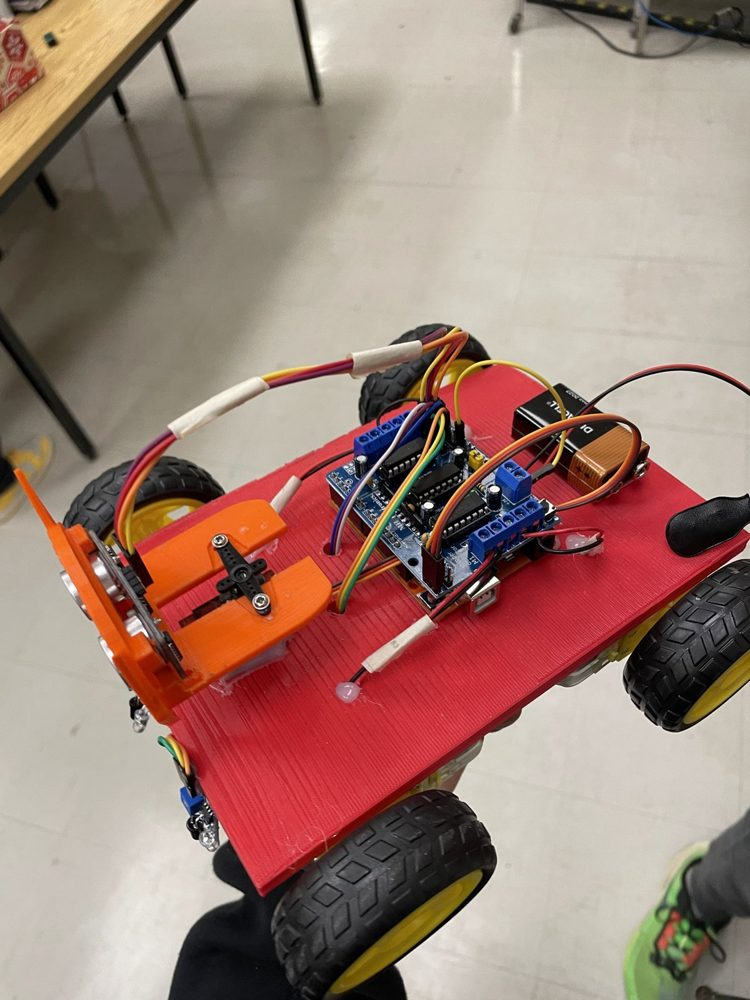
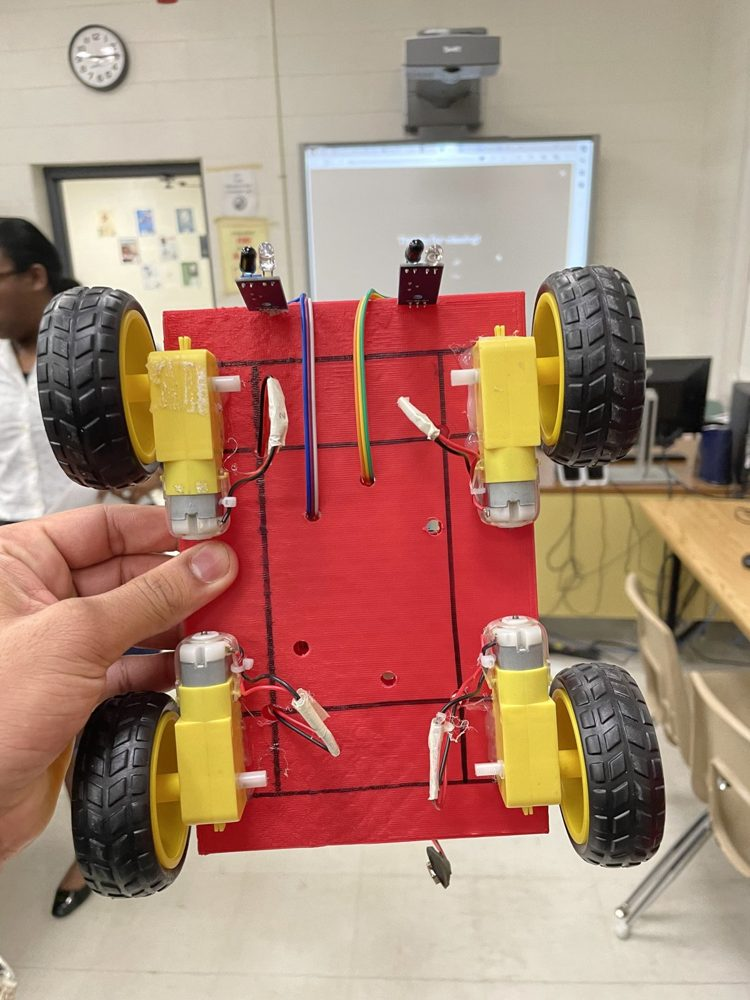

# Line-Following Robot with Obstacle Avoidance

A 4-wheel-drive Arduino robot that follows a black-tape line on the floor, drives around obstacles in its path, then finds the line again and continues its route.

## How it works

The code is a small state machine:

1. **Follow line:** two IR sensors under the front bumper read the tape. If the line drifts under one sensor, the robot steers back toward it.
2. **Avoid obstacle:** every 60 ms the ultrasonic sensor checks ahead. If something is closer than 15 cm, the robot stops, turns the servo to measure left and right, and drives around on the side with more room.
3. **Find line:** after passing the obstacle, the robot angles back, drives until a sensor sees tape again, and returns to following. If it can't find the line within 2.5 s, it stops safely.

## Hardware

| Part | Connection |
| --- | --- |
| Arduino Uno | Controller |
| L293D motor shield (Adafruit Motor Shield v1 compatible) | Stacked on the Uno |
| 4x DC gear motors | Shield M1 (front left), M2 (rear left), M3 (rear right), M4 (front right) |
| Left / right IR line sensors | A0 / A1 |
| HC-SR04 ultrasonic sensor | Trig A2, Echo A3 |
| SG90 servo (sensor head) | Shield SERVO_1 header (pin 10) |

The motor shield uses digital pins 3–8, 11 and 12, so the sensors use the analog header as digital pins.

## Upload

1. Install the **Adafruit Motor Shield library** (AFMotor, v1) from the Arduino Library Manager.
2. Open `LineFollower/LineFollower.ino` in the Arduino IDE, select **Arduino Uno**, and upload.
3. Open the Serial Monitor at 9600 baud to see obstacle readings.

## Tuning

All tuning values are at the top of the sketch:

- `ON_LINE`: set to `LOW` if your IR modules read the opposite way
- `CRUISE_SPEED`, `TURN_SPEED`: motor PWM (0–255)
- `OBSTACLE_CM`: stopping distance
- `AVOID_TURN_MS`, `AVOID_SIDE_MS`, `AVOID_PASS_MS`: timing for the detour; adjust for your battery and floor

## Photos

| Top | Underside |
| --- | --- |
|  |  |
